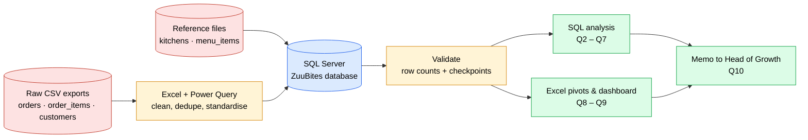
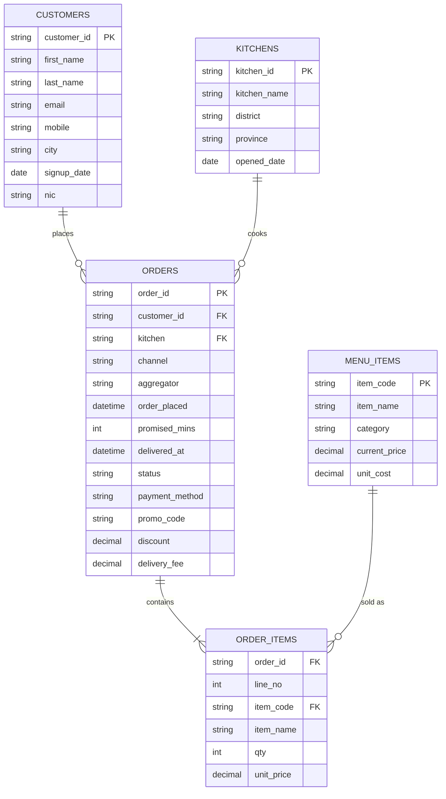
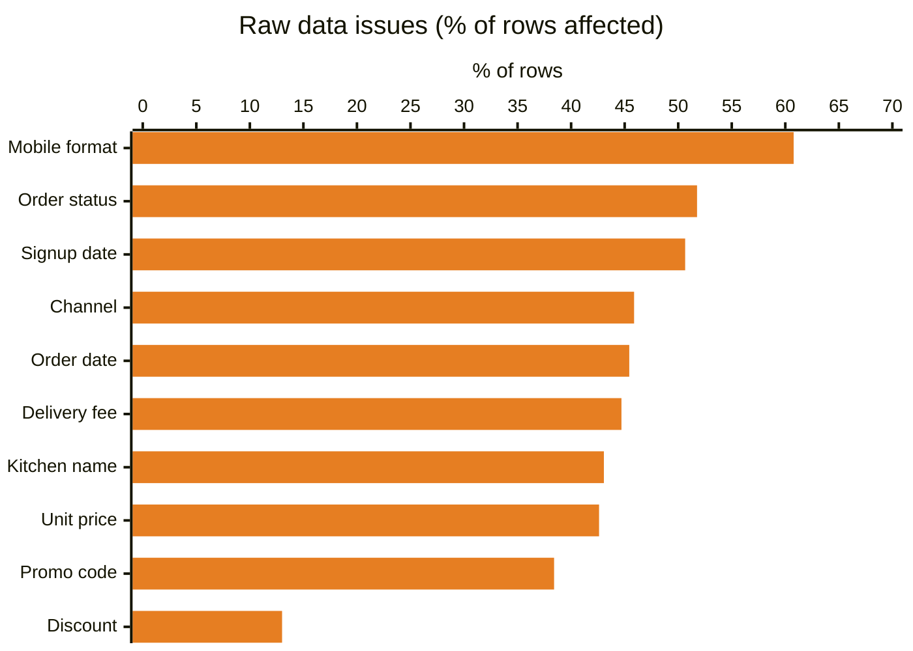
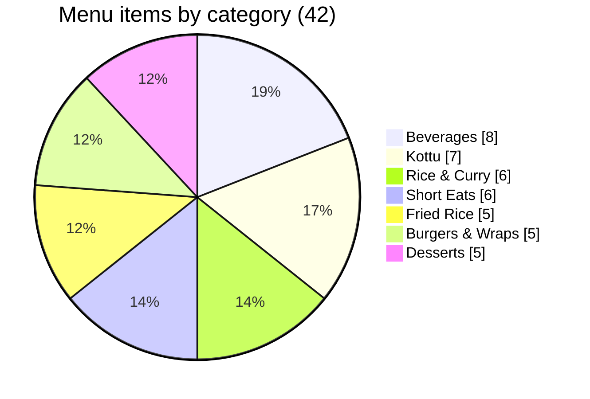
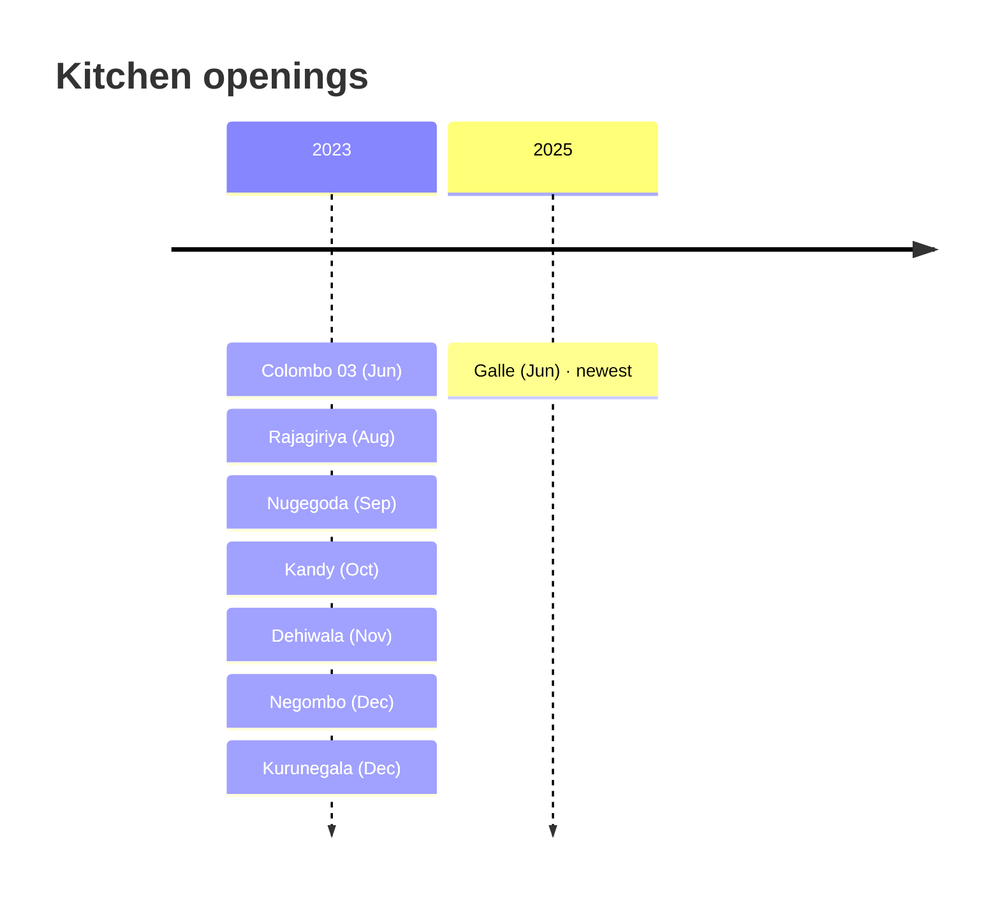
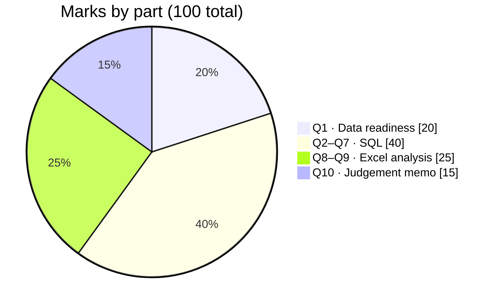
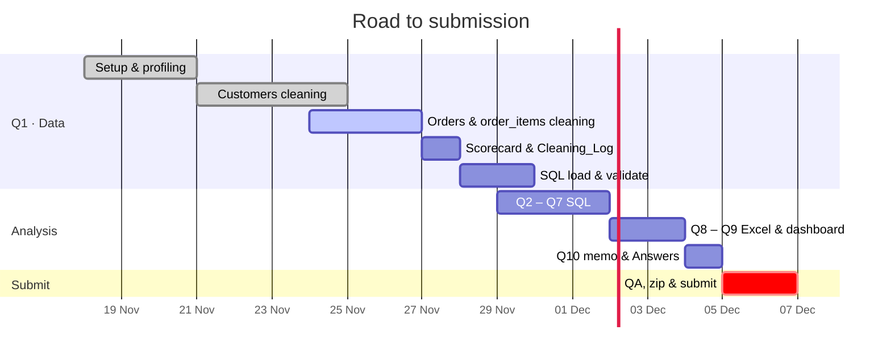
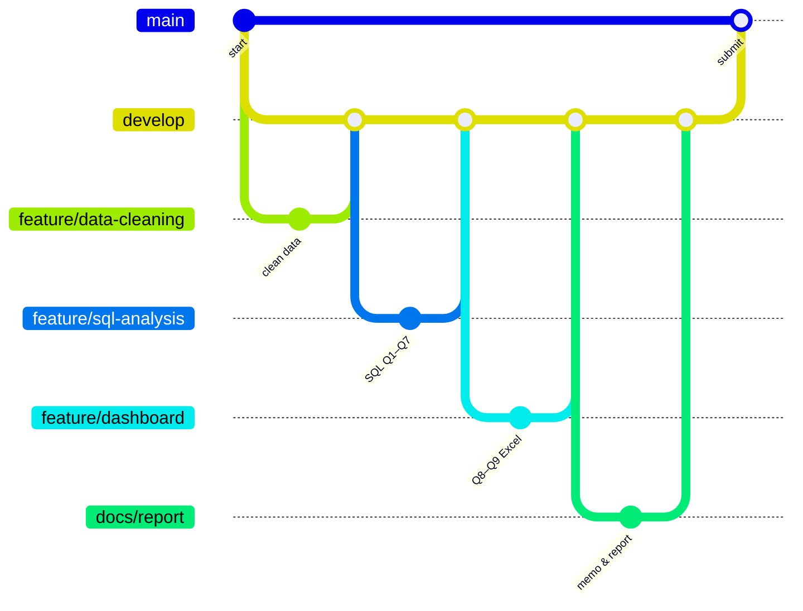

<div align="center">

# ZuuBites · Excel + SQL Capstone

**Turning three messy system exports from a Sri Lankan cloud-kitchen brand into answers managers can act on.**


</div>

---

## The story

ZuuBites cooks kottu, rice & curry, fried rice, burgers, short eats, desserts and drinks in **8 delivery-only kitchens**. It sells through **4 channels**: App, Web, Phone, and two aggregator platforms (TukEats and DashLK).

Until now, every report has been built by hand from system exports, and nobody trusts the numbers. As ZuuBites' first data analyst, I take every order from **1 Jan 2024 to 18 Dec 2025** and:

1. **Clean** the raw exports in Excel and Power Query
2. **Load** them into a SQL Server database, then validate them
3. **Answer** nine managers' questions with SQL and Excel
4. **Recommend** a decision in a short memo

> *Part of the Zuu Crew "Zero to Data Analyst: Data Foundations" programme.*

---

## How the data flows



---

## The data model

Five tables go into the `dbo` schema of the **ZuuBites** database.



> Aggregator orders (TukEats, DashLK) have **no Customer ID** and **no delivery fee**, because the platforms don't share customer details.

---

## How messy was the raw data?

I profiled the three raw files with **24 checks across 21 columns and 5 quality dimensions**. These are the biggest problems, as **% of rows affected**:



<details>
<summary><b>See all 24 checks</b></summary>

| # | File | Column | Check | Dimension | Rows | % rows |
|--:|------|--------|-------|-----------|-----:|------:|
| 1 | orders | (whole row) | Exact duplicate rows | Uniqueness | 320 | 0.98% |
| 2 | orders | Kitchen | Not one of the 8 official kitchen names | Consistency | 14,095 | 43.06% |
| 3 | orders | Kitchen | "Test Kitchen" (not a real kitchen) | Validity | 6 | 0.02% |
| 4 | orders | Channel | Not exactly App / Web / Phone / Aggregator | Consistency | 15,021 | 45.88% |
| 5 | orders | Status | Not exactly Delivered / Cancelled | Consistency | 16,946 | 51.76% |
| 6 | orders | Order Placed | Not in ISO yyyy-mm-dd hh:mm format | Validity | 14,872 | 45.43% |
| 7 | orders | Discount | Text with % or a whole number | Validity | 4,260 | 13.01% |
| 8 | orders | Delivery Fee | Text with an "Rs" prefix | Validity | 14,633 | 44.70% |
| 9 | orders | Promo Code | Placeholder for "no code" (none, N/A, NULL, -) | Consistency | 12,573 | 38.41% |
| 10 | orders | Customer ID | Blank on a non-aggregator order | Completeness | 0 | 0.00% |
| 11 | orders | Delivered At | Delivered order with no delivery time | Completeness | 0 | 0.00% |
| 12 | order_items | (whole row) | Exact duplicate rows | Uniqueness | 714 | 0.98% |
| 13 | order_items | Qty | Blank (rule: blank means 1) | Completeness | 447 | 0.61% |
| 14 | order_items | Qty | Negative quantity | Validity | 293 | 0.40% |
| 15 | order_items | Unit Price | Text ("Rs." or thousands comma) | Validity | 31,117 | 42.61% |
| 16 | order_items | Item Code | Code not in menu_items (M090, M091) | Validity | 565 | 0.77% |
| 17 | order_items | Item Name | Name differs from the menu name for its code | Consistency | 3,685 | 5.05% |
| 18 | customers | (whole row) | Exact duplicate rows | Uniqueness | 35 | 0.61% |
| 19 | customers | NIC | Same person under 2 Customer IDs | Uniqueness | 110 | 1.91% |
| 20 | customers | Email | Blank | Completeness | 418 | 7.28% |
| 21 | customers | Email | Contains upper-case letters | Consistency | 848 | 14.76% |
| 22 | customers | Mobile | Not in 07XXXXXXXX format | Validity | 3,492 | 60.78% |
| 23 | customers | City | Blank | Completeness | 183 | 3.19% |
| 24 | customers | Signup Date | Not in ISO yyyy-mm-dd format | Validity | 2,910 | 50.65% |

Rows used for %: orders 32,737 · order_items 73,033 · customers 5,745 (raw, before cleaning).

</details>

### From raw to clean: the checkpoints

| Table | Raw rows | Clean rows (checkpoint) | Removed | Status |
|-------|---------:|------------------------:|--------:|:------:|
| customers | 5,745 | **5,600** unique people | 145 | ✅ cleaned |
| orders | 32,737 | **32,411** | 326 | 🔄 in progress |
| order_items | 73,033 | **72,313** | 720 | 🔄 in progress |

**2025 checkpoint:** 18,305 delivered orders worth **Rs 59,928,441** in net revenue.

> 💡 **Key finding so far:** net revenue only matches the checkpoint when negative quantities are treated as data-entry sign errors and turned positive. Keeping them negative gives Rs 59,435,682, which is Rs 492,759 short.

---

## 🍽️ The business at a glance

<table>
<tr>
<td width="50%" valign="top">



</td>
<td width="50%" valign="top">



</td>
</tr>
</table>

---

## The questions I'm answering



| Q | Asked by | Question | Tool | Marks | Status |
|:-:|----------|----------|:----:|:-----:|:------:|
| 1 | Data lead | Make the data trustworthy: scorecard, cleaning log, load, validate | Excel / PQ + SQL | 20 | 🔄 |
| 2 | Head of Operations | Which kitchen is really performing? | SQL | 6 | ⬜ |
| 3 | Operations manager | Are we keeping our delivery promise? | SQL | 6 | ⬜ |
| 4 | Head of Menu | What should stay on the menu? | SQL | 7 | ⬜ |
| 5 | CRM manager | Who should we win back? | SQL | 7 | ⬜ |
| 6 | CEO | Are we growing? | SQL | 7 | ⬜ |
| 7 | Head of Loyalty | Does a bad first order cost us the customer? | SQL | 7 | ⬜ |
| 8 | Marketing manager | Did Kottu Tuesday (buy one, get one free) pay off? | Excel | 12 | ⬜ |
| 9 | Operations director | A one-page operations dashboard | Excel | 13 | ⬜ |
| 10 | Head of Growth | Should we push customers to the aggregators? | Memo + SQL | 15 | ⬜ |

✅ done · 🔄 in progress · ⬜ to do

---

## Business rules used everywhere

| Term | Rule |
|------|------|
| **Net revenue** | Qty × Unit Price (on the order line) × (1 − Discount) |
| **Gross profit** | Net revenue − Qty × unit cost (from menu_items) |
| **AOV** | Net revenue ÷ number of orders |
| **What counts** | Only *Delivered* orders count towards revenue, profit and AOV |
| **Delivery fee** | Never revenue |
| **On time** | Delivered within Promised Mins of Order Placed |
| **Blank Qty** | Means 1 |
| **Free (BOGO) items** | Their own order line with Unit Price 0 |

---

## Roadmap



---

## Repository structure

```text
zuubites-excel-sql-capstone/
├── Data/
│   ├── Original Dataset/   ← raw CSVs, never edited
│   ├── Original Excels/    ← .xlsx working copies of the raw files
│   ├── Cleaning Dataset/   ← cleaning workbooks (customers, orders, order_items)
│   └── Data_Cleaned/       ← final cleaned outputs
├── docs/                   ← project plan & progress report
├── ZuuBites Take-Home Assessment.pdf
└── README.md
```

## Branches



`feature/*` and `docs/report` → `develop` → `main` (final, submission-ready).

---

<div align="center">

**Arundethie Wijerathne** · Zero to Data Analyst capstone · 2026

</div>
